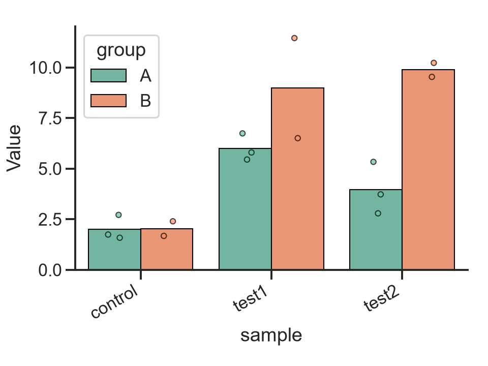

# Aphrodite is Seaborn

A personal plotting library built on [Seaborn](https://seaborn.pydata.org/), with helpers for plots I use often. This is a personal project, so expect bugs.

## Installation

Requires Python 3.12 or newer. Clone the repository and install locally:

```sh
git clone https://github.com/ym3141/aphrodite.git
cd aphrodite
python -m pip install .
```

## Example

Plot group means with individual observations overlaid:

```python
import matplotlib.pyplot as plt
import numpy as np
from aphrodite import bar_point_plot, rotate_xtick_labels

data = {
    "group": ["A", "A", "A", "B", "B"] * 3,
    "sample": ["control", "test1", "test2"] * 5,
    "value": [.3, 4, 4, .4, 5, 1, .3, 5, 8, .6, 4, 2, .8, 10, 9] + np.random.random(15) + 1,
}

ax = bar_point_plot(data=data, x="sample", y="value", hue="group", legend='brief')
ax.set(xlabel="sample", ylabel="Value")
rotate_xtick_labels(ax, 30)
plt.tight_layout()
plt.show()
```


